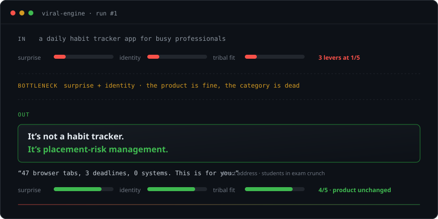
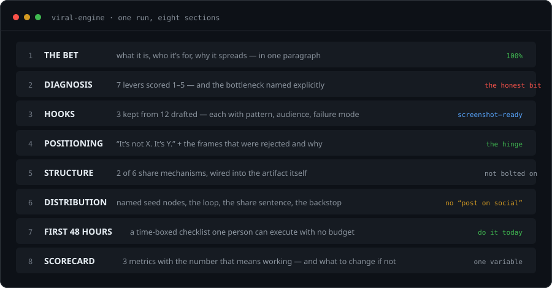
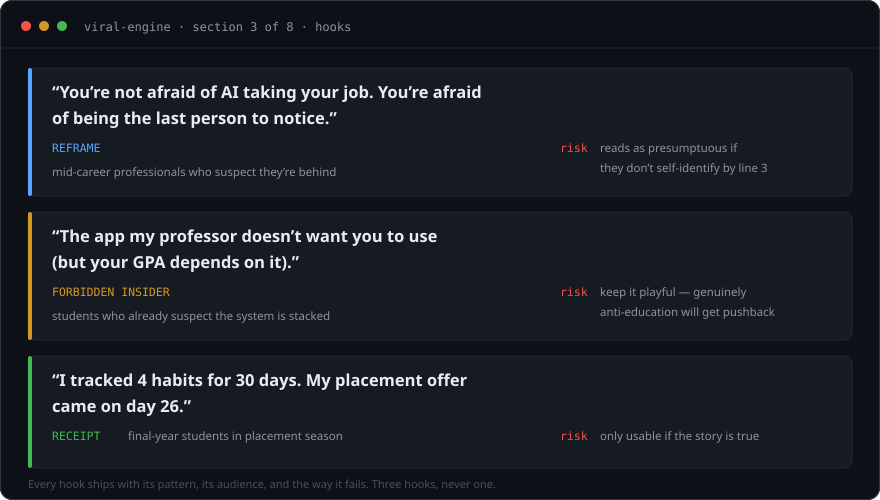

<div align="center">


# 🚀 Viral Engine

### The reason your work didn't spread isn't the writing. It's the category.

**A Claude Skill that diagnoses why something isn't spreading — then rebuilds it.**

[](https://opensource.org/licenses/MIT)
[](https://claude.ai)
[](#-try-it-now)
[](https://github.com/mananmodi1487/viral-engine/pulls)
[](https://github.com/mananmodi1487/viral-engine/stargazers)

[**▶ Try it now (one click)**](#-try-it-now) · [Proof it works](#-proof-it-works) · [The shocking part](#-the-part-that-should-shock-you) · [Templates](templates/) · [Case study](CASE_STUDY.md)

</div>

---

## 51.7% of newly published articles on the web are AI-generated.

That's the share Graphite measured in May 2025, up from 2.2% in January 2020, across a sample of 65,000 English-language articles pulled from Common Crawl. Their detector is not gospel — AI-detection accuracy is contested, and their own testing mislabeled 4.2% of human articles. Treat it as directional.

Here's the direction: **the internet just got flooded with competent, forgettable writing.**

Which means the scarce thing is no longer *good* content. Good content is free and infinite now.

The scarce thing is content that a specific person feels compelled to send to another specific person.

**Nobody is solving that. That's the gap this repo lives in.**

---

### The part nobody tells you

You can have excellent writing and still get nothing. Not because the hook was weak — because you were competing in a category where nobody was looking for you.

Watch what happens to the same product:



Same app. Same features. Same code.

**Different game.** One of them is competing with 40,000 habit trackers. The other is competing with nobody, because nobody had named it yet.

> *"It's not a habit tracker. It's placement-risk management — for students who are one missed deadline away from a bad semester."*

That's not a better sentence. That's a different category — with a different audience, a different emotion, and a different reason to share it.

**Positioning beats polish. Almost every time.** And almost nobody does it, because it's harder than writing a better hook.

---

## ▶ Try it now

No install. No API key. No clone.

**Option 1 — one click, in Claude:**

&nbsp;&nbsp;&nbsp;&nbsp;[**→ Open the skill in Claude**](https://claude.ai/new?q=%2Fviral-engine%20I%20built%20a%20daily%20habit%20tracker%20app%20for%20busy%20professionals)

**Option 2 — paste this anywhere:**

```
Read https://raw.githubusercontent.com/mananmodi1487/viral-engine/main/SKILL.md
and then run it on: [your thing here]
```

**Option 3 — install it properly:**

```bash
mkdir -p ~/.claude/skills/viral-engine
curl -fsSL https://raw.githubusercontent.com/mananmodi1487/viral-engine/main/SKILL.md \
  -o ~/.claude/skills/viral-engine/SKILL.md

# then just type:
/viral-engine a daily habit tracker app for busy professionals
```

**What you get back:** eight sections, in order, every time.



Not inspiration. A decision you can act on before lunch.

### 🏆 The #ViralEngineChallenge

Run it on something of yours. Post the before/after. Tag it **`#ViralEngineChallenge`**.

The format looks like this — *illustrative, not a real run. Yours has to be.*

```diff
- BEFORE:  "A note-taking app for students"
+ AFTER:   "It's exam triage — for students who don't need better notes,
           they need to know what to skip before Thursday."
```

Two rules: **the input has to be real**, and **the output has to be what the skill actually said** — including the parts you didn't like. The uncomfortable ones are the interesting ones.

→ Post it anywhere with the tag, or open an issue with your output. The best get added to [`examples/`](examples/), with credit.

---

## 🧪 Proof it works

*(Honest header: these are **worked examples of the reasoning**, not case studies with verified outcomes. The numbers in them are placeholders on purpose — see [the honesty policy](#-the-honesty-policy). Anyone showing you a growth tool with eight triumphant case studies on day one is showing you fiction.)*

### Before → after, three real inputs

| Input | What it did | What the diagnosis found | What came back |
|---|---|---|---|
| *"A daily habit tracker app for busy professionals"* | Nothing. Category with 40k competitors. | surprise 1/5, identity 1/5, tribal fit 1/5 → **bottleneck: no tension, no tribe** | Placed as **placement-risk management**. Hook: *"47 browser tabs, 3 deadlines, 0 systems. This is for you."* |
| *"Blog post about AI anxiety"* | A saturated topic. Scrolled past at 200 words. | surprise 2/5, remixability 1/5 → **bottleneck: nothing unexpected, nothing to do afterward** | Placed as **workplace change literacy**. Hook: *"You're not afraid of AI taking your job. You're afraid of being the last person to notice."* |
| *This repository* | "Another AI growth tool." Distrusted category. | emotion 2/5 → **bottleneck: clever, not activating** | Placed as a **spread diagnostic**. Led to the before/after asset you just scrolled past. |

**The full reasoning — including the frames that were rejected and why — is in [`examples/`](examples/) and [`CASE_STUDY.md`](CASE_STUDY.md).**

### And here's what three hooks look like when they ship with their failure modes



Every hook comes with the way it breaks. That's the difference between a hook generator and a diagnostic: **one gives you lines, the other tells you which line will get you dunked on.**

---

## ⚡ The part that should shock you

Four findings that contradict what most growth marketing says out loud. All cited, all in [`research/virality-patterns.md`](research/virality-patterns.md).

**1. "Going viral" barely exists.** Across ~1 billion diffusion events on Twitter, cascades larger than 100 nodes were about **0.025%** of all events. The average cascade: 1.3 nodes.

**2. Popularity is a broadcast, not a chain.** Structural virality is typically *low* and stays low regardless of size. What predicts a big event is the size of the **single largest broadcast** — not thousands of people passing it along.

> Everyone optimizes for the chain. The data points at the megaphone.

**3. Sadness makes people stop.** Awe, anger, anxiety and amusement increase sharing. Sadness — equally powerful, subjectively — *decreases* it, because it deactivates. The variable isn't "emotional." It's **activation**.

**4. Half of YouTube videos have under 500 views.** Facebook and Twitter are technologies, not strategies. Only ~7% of word of mouth happens online — we overestimate it because the online part leaves traces.

### 🔑 And the pattern almost nobody names

From #2 above comes the thing this whole repo is built around:

> ### The Broadcaster Rule
> **Don't optimize for the average share rate. Optimize for the ease of one specific broadcast.**

Standard advice treats sharing as a per-person probability to nudge upward. The diffusion data treats popularity as a function of the largest single broadcast. Optimizing a mean when the outcome is driven by a maximum is how people burn six months on the wrong metric.

So the skill forces you to answer three questions, in order:

1. **Who is the broadcaster?** A real handle. Not a persona.
2. **What do they need?** A clean screenshot, a paste-able one-liner, and a reason it makes *them* look good.
3. **What's their stake?** Nobody amplifies for you. They amplify for a position.

That's not a growth hack. It's a much more boring and much more workable plan than "go viral," which is exactly why it might work.

---

## 🛡️ The honesty policy

This is the part most growth tooling gets wrong, so it's enforced in the skill file rather than promised in a manifesto:

| | |
|---|---|
| ❌ **No invented statistics** | Missing number → `[your real number]` + what to measure |
| ❌ **No fabricated testimonials** | The examples carry a `guardrail_check` block you can audit |
| ❌ **No guaranteed outcomes** | Nobody can promise 100K stars. This promises a better-designed attempt. |
| ❌ **No manufactured outrage** | Excluded from the skill, not merely discouraged. Short-term reach, long-term reputation. |
| ✅ **Every plan ships with a failure condition** | *"This fails if ___"* — because a plan without one isn't a plan |
| ✅ **"Don't launch yet" is a valid answer** | A tool that always says yes is a slot machine |

You'll notice the examples contain `[bracketed]` placeholders instead of impressive numbers.

That's not a gap in the docs. **That's the product.**

---

## 🪞 The suspicious part

> ### This README was built with Viral Engine.

Which means you can grade it.

The diagnosis said **emotion 2/5** — clever, not activating. That's why there's a before/after card instead of a feature list, and why this document has a villain (forgettable content) instead of a feature section.

The positioning chose **diagnostic** over "AI growth tool" — which cost excitement and bought the license to say *"your idea isn't ready."*

The case study is in [`CASE_STUDY.md`](CASE_STUDY.md), and **the results section is empty**, because the repo is days old.

Yes, the tool is self-aware. No, it isn't magic — it's a checklist that refuses to flatter you. Judge it by whether *this page* made you want to run it on your own thing. If it did, the mechanism works. If it didn't, it doesn't — and you just saved yourself a launch.

---

## 🔬 What's different from every other growth tool

Full comparison, including where the alternatives are better: **[`IMPROVEMENTS.md`](IMPROVEMENTS.md)**

**The one-sentence version:** other tools help you write something that *sounds* viral. This one names **why the thing didn't spread**, and won't let you skip it.

- **A bottleneck, not a checklist** — 7 levers scored, the weakest named, fix only that
- **Two share mechanisms, never three** — three reads as desperate
- **Position before you write** — a new category generates hooks; a new hook can't rescue a dead category
- **Honesty as a hard constraint** — enforced in the output format, not in the marketing copy
- **A scorecard with the number that means "stop"** — including *"fix honesty before reach"*

---

## 📂 What's in the repo

```
viral-engine/
├── SKILL.md                      ← the whole product. one file. no deps.
├── README.md                     ← you're here (built by the thing above ☝️)
├── IMPROVEMENTS.md               ← the honest diff vs. other tools
├── CASE_STUDY.md                 ← this repo diagnosed by itself
├── SUMMARY.md                    ← launch playbook + why 100K isn't plannable
├── CREDITS.md                    ← Berger · Goel/Watts · Lowenstein · NYT · Claude
├── assets/                       ← diagrams — SVG, animated, editable
├── templates/                    ← 4 copy-paste frameworks
│   ├── hook-factory.md
│   ├── positioning-worksheet.md
│   ├── share-structure-canvas.md
│   └── launch-checklist.md
├── research/
│   ├── virality-patterns.md      ← the cheat sheet, with citations + caveats
│   └── README.md                 ← established vs. inferred
└── examples/
    ├── student-app-example.json
    └── blog-post-example.json
```

**Every template is a blank to fill in, not a thing to read.** That's deliberate — filling blanks produces better answers than reading advice, and it's slower, which is the point.

---

## 🎯 When to use it

- Something you published got nothing and you don't know why
- You're launching and the description sounds like everyone else's
- You have hooks that aren't landing
- You want to know *why* something spread, not just that it did
- You're about to spend money on ads you haven't earned the right to buy

**Not for:** buying engagement, manufacturing controversy, or dressing up a weak product. The skill will tell you when the honest answer is *don't launch yet*.

---

## 🤝 Contributing

The most valuable PRs, in order:

1. **Counter-examples** — things that looked viral-ready and flopped, and why. Worth more than ten more success stories.
2. **New hook patterns** with a real example and the audience they target
3. **New share mechanisms** — especially ones that don't need a network effect
4. **Domain examples** — local businesses, B2B, education, non-profits, dev tools

**Please keep the honesty guardrails intact.** A PR that adds fabricated social proof will be closed, and the reason will be quoted in the thread.

---

## 📜 License

MIT — see [LICENSE](LICENSE). Build what spreads.

<div align="center">

### Run it on the thing that didn't work.

Then tell us what it said — especially if it said something you didn't want to hear.

[**▶ Try it in Claude**](https://claude.ai/new?q=%2Fviral-engine%20I%20built%20a%20daily%20habit%20tracker%20app%20for%20busy%20professionals) · [⭐ Star](https://github.com/mananmodi1487/viral-engine) · [Read the skill](SKILL.md) · [Launch playbook](SUMMARY.md) · [Case study](CASE_STUDY.md)

<sub>Built with [Claude](https://claude.ai). Research credited in [CREDITS.md](CREDITS.md). Not affiliated with Anthropic.</sub>

</div>
