<div align="center">



# 🚀 Viral Engine

### Your work didn't spread because of the category, not the writing.

**A CLI and Claude Skill that diagnoses why something didn't spread — then rebuilds it.**

[](https://www.npmjs.com/package/viral-engine)
[](https://github.com/mananmodi1487/viral-engine/actions/workflows/ci.yml)
[](https://opensource.org/licenses/MIT)
[](tests/)
[-blue)](package.json)
[](#-privacy)

[**60-second start**](#-try-it-in-60-seconds) · [See real output](#-what-you-actually-get) · [How it works](docs/architecture.md) · [Scoring](docs/scoring.md) · [Honesty policy](docs/honesty-policy.md)

</div>

---

## The 30-second version

You published something. Nobody shared it. You rewrote the hook, improved the copy, posted at a better time. Still nothing.

**Viral Engine scores seven levers, names the single weakest one, and tells you what to fix first** — not with adjectives, but with a scorecard you can diff, a broadcaster brief you can send, and a failure condition you can check.

```
$ npx viral-engine analyze ./README.md --offline

  viral-engine v1.0.0  ./README.md
  ──────────────────────────────────────────────────────────
    52/100  overall
    weakest lever: Proof Readiness (51/100)

    Category Clarity                      █████████████████░░░  87 structural
    Broadcaster Fit                       ███████████████░░░░░  75 structural
    Share Friction                        ███████████░░░░░░░░░  56 measured
    Emotional Stake                       ██████████████░░░░░░  70 heuristic
    Proof Readiness                       ██████████░░░░░░░░░░  51 measured
    Launch Timing                         ████████████░░░░░░░░  60 heuristic
    Honesty Risk (lower is better)        █████████░░░░░░░░░░░  43 measured

    category     growth / marketing tooling (low)
    proposed     It's not growth / marketing tooling. It's spread
                 diagnostics for people who already published.
    broadcaster  One practitioner who already writes about this problem
    fix first    Add one screenshot-ready artifact a reader can forward
                 without explanation.
```

That's real output, generated from this repo's own `SKILL.md`. Every number carries a **basis** — `measured`, `structural`, or `heuristic` — because pretending all seven are equally rigorous is how scorecards start lying.

---

## ⚡ Try it in 60 seconds

**Option A — no install, in Claude:**

```
Read https://raw.githubusercontent.com/mananmodi1487/viral-engine/main/SKILL.md
and then run it on: [your thing here]
```

**Option B — the CLI:**

```bash
git clone https://github.com/mananmodi1487/viral-engine && cd viral-engine
npm ci
npx tsx packages/cli/src/index.ts analyze ./README.md --offline
```

**Option C — one command, no clone:**

```bash
npx viral-engine analyze owner/repo          # a GitHub repo
npx viral-engine analyze ./README.md         # a local file
npx viral-engine analyze https://yours.com   # a landing page
npx viral-engine analyze --text "your copy"  # pasted text
```

No API key needed. No telemetry. `--offline` makes zero network calls.

---

## 📊 What you actually get

Eight sections, in this order, every time:

| # | Section | What it answers |
|---|---|---|
| 1 | **Scorecard** | Which of seven levers is weakest, and what to do about it |
| 2 | **Category** | What you're really competing with, plus 3 less-crowded adjacent categories |
| 3 | **The broadcaster** | One named kind of person, where to find them, a paste-ready message, and what not to say |
| 4 | **Share friction** | Why forwarding is expensive, with a fix per friction |
| 5 | **Honesty check** | Anything that would get you publicly corrected |
| 6 | **Launch assets** | Show HN, X thread, LinkedIn, Product Hunt, hero copy, email subjects, chat announcement |
| 7 | **Pre-launch checklist** | Blockers first, reasoning attached to each |
| 8 | **Kill criteria** | Written *before* launch so they can't be rationalised after |

Full example: [`examples/reports/example-report.md`](examples/reports/example-report.md) · [JSON](examples/reports/example-report.json) · HTML via `--format html`

---

## 🎯 Use cases

**Launching an open-source repo** — find out whether your README names a category or just describes features.

```bash
npx viral-engine analyze yourname/yourrepo
```

**Rewriting a landing page** — the page that converts is usually in a different category than the one you wrote.

```bash
npx viral-engine analyze https://yoursite.com
```

**Diagnosing a newsletter or essay** — before you spend a week on the next one.

```bash
npx viral-engine analyze ./draft.md --offline
```

**Preparing a Product Hunt launch** — get the tagline, the description, and the one broadcaster to approach.

**Finding the right broadcaster** — the section most launch checklists skip entirely.

---

## ⚡ Four findings that contradict common advice

All cited in [`research/virality-patterns.md`](research/virality-patterns.md).

**1. "Going viral" barely exists.** Across ~1 billion diffusion events, cascades larger than 100 nodes were about **0.025%** of all events. The average cascade: 1.3 nodes. *(Goel, Watts & Goldstein, 2012/2016)*

**2. Popularity is a broadcast, not a chain.** Structural virality is typically low and stays low regardless of size. What predicts a big event is the size of the **single largest broadcast**.

**3. Sadness makes people stop.** Awe, anger, anxiety and amusement increase sharing. Sadness — equally intense — *decreases* it, because it deactivates. The variable isn't "emotional", it's **activation**. *(Berger & Milkman, 2012)*

**4. Half of YouTube videos have under 500 views.** Only ~7% of word of mouth happens online. *(Berger, 2013)*

### 🔑 The Broadcaster Rule

From #2:

> **Don't optimise the average share rate. Optimise the ease of one specific broadcast.**

So the tool refuses to emit advice without naming *a kind of person*, where to find them, and why they'd bother. "Post on social media" is rejected by the type system — `BroadcasterBrief` requires `whereToFind`, `messageTemplate`, `whatNotToSay`, and `likelyAmplifier`.

---

## 🛡️ Honesty is enforced in code, not promised in a README

| Rule | Enforcement |
|---|---|
| No invented statistics | `honesty.ts` blocks unsourced figures; generated assets emit `[your real number]` |
| No fabricated testimonials | An **outbound** scan of our own output blocks testimonial shapes |
| No guaranteed outcomes | Guarantee phrasing is a `blocker` |
| Every plan states a failure condition | `assertFailureConditions()` **throws** if any is missing |
| "Do not launch yet" is valid | First-class output, banner in every renderer, exits 3 in CI |
| Unknown is stated, not guessed | Saturation returns `unknown`, never a default number |

**The outbound pass is the unusual one.** Before any report reaches you, the generator scans *its own text* with stricter rules than it applies to yours. It caught two real bugs during development — including the tool flagging its own honest disclaimer — both now regression-tested. Details: [`docs/honesty-policy.md`](docs/honesty-policy.md).

---

## 🔬 What's different from every other growth tool

Full comparison, including where alternatives are better: [`IMPROVEMENTS.md`](IMPROVEMENTS.md)

- **A bottleneck, not a checklist** — seven levers scored, the weakest named, fix only that
- **Deterministic scores** — an LLM can only *explain*; it can never set a score or invent a broadcaster
- **Two share mechanisms, never three** — three reads as desperate
- **A scorecard that says "stop"** — including *"fix honesty before reach"*
- **Runs with no model at all** — local-first, no vendor lock-in

---

## 🏗️ Architecture

```
packages/
  core/          signals → score → categories → broadcasters → assets → validate
    providers/   anthropic · openai · ollama · groq · mistral · together
  cli/           analyze <target> --format terminal|md|json|html
  web/           dependency-free UI, no telemetry
.github/
  actions/spread-check/   PR comment + honesty gate
docs/            architecture · quickstart · scoring · honesty-policy · migration
prompts/         versioned prompt set (diagnose, positioning, broadcaster, assets)
fixtures/        labelled evaluation cases
tests/           49 tests + evaluation harness
```

**One design decision drives everything:** scoring is a pure function of extracted signals. The only non-deterministic stage is optional prose, and it cannot write to any scored field. That is why the same input produces byte-identical JSON — there's a test for it.

Read more: [`docs/architecture.md`](docs/architecture.md)

---

## 🔒 Privacy

- **No telemetry.** Not a line of analytics code in this repo.
- **`--offline`** makes zero network calls; the entire diagnosis still works.
- **API keys** are read from the environment only. They are never logged, never written to the report, never included in error messages.
- **Local models first.** Ollama is checked before any hosted provider.
- **HTML reports are self-contained** — no external assets, no scripts, safe to email.

---

## ❓ FAQ

**Does this guarantee virality?** No. Nothing can. Roughly 150–200 repos have ever passed 100K stars and nearly all did so through one uncontrollable distribution event. This improves the quality of the attempt.

**Does it fabricate statistics?** No — it's structurally prevented. Generated copy uses placeholders; blockers fail the build.

**Can I use it locally?** Yes, fully. `--offline --provider none` is the default path, not a degraded one.

**Is it only for GitHub repos?** No — repos, URLs, files, or pasted text.

**Why does it sometimes say "do not launch yet"?** Because that's a valid result. One unpolished launch attempt per project is the real constraint; a launch that can't produce signal is worse than a delay.

**Do I need an API key?** No. The deterministic engine is the product; a provider only adds narrative prose.

**How accurate is it?** See [`docs/scoring.md`](docs/scoring.md). The benchmark is 7 fixtures at 100% — a smoke test, not evidence of generalization, and the docs say so.

---

## 🤝 Contributing

Most valuable, in order: **counter-examples** (things that looked viral-ready and flopped), new honesty rules with fixtures, new providers, non-tech case studies.

Setup, rules, and what gets closed: [`docs/contributing.md`](docs/contributing.md)

```bash
npm test        # 49 tests
npm run bench   # precision/recall gate on labelled fixtures
```

**Please keep the honesty guardrails intact.** A PR adding fabricated social proof will be closed and the reason quoted.

---

## 📜 License

MIT — see [LICENSE](LICENSE).

<div align="center">

### Run it on the thing that didn't work.

Then tell us what it said — especially if it said something you didn't want to hear.

[**⚡ Try it**](#-try-it-in-60-seconds) · [⭐ Star](https://github.com/mananmodi1487/viral-engine) · [Read the skill](SKILL.md) · [Architecture](docs/architecture.md) · [Case studies](examples/)

<sub>Built with [Claude](https://claude.ai). Research credited in [CREDITS.md](CREDITS.md). Not affiliated with Anthropic.</sub>

</div>

<!-- Easter egg: the engine flags a star promise as an honesty blocker, so this line is
     deliberately phrased as a wish rather than a forecast. Run the tool on this file
     and see for yourself — that is the whole pitch in one command. -->
